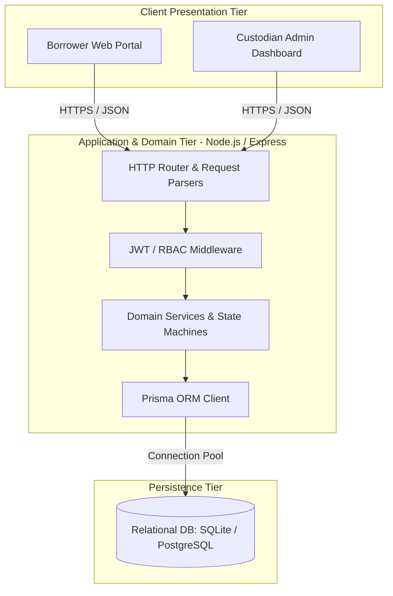
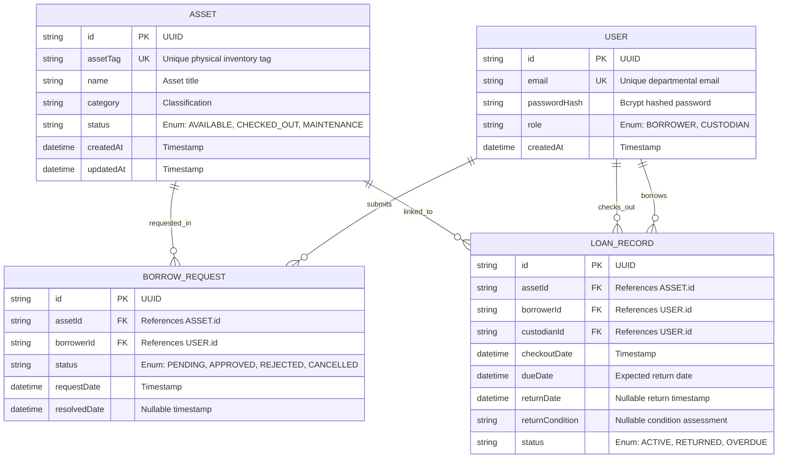

For `docs/system-sds.md`, replacing fragile ASCII art with native GitHub-rendered Mermaid diagrams resolves the text-wrapping and formatting issues across viewports.

Open **`docs/system-sds.md`** in VS Code, replace its entire content with the markdown below, and save the file (`Ctrl + S`):

```markdown
# System-Level Software Design Specification (System SDS)
## Theme 2: Inventory and Borrowing System
**Course:** CPE 334 Software Engineering in the Age of AI Agents  
**Semester:** 1/2026  
**Repository:** https://github.com/Ryugc/Inventory-and-Borrowing-System  

---

## 1. System Architecture

### 1.1 Architectural Topology
The system utilizes a 3-tier Client-Server architecture separated by a RESTful HTTP/JSON interface. Backend execution follows a strict separation of concerns across routing, authentication middleware, domain workflow verification, and ORM persistence.



### 1.2 Component Breakdown

* **Routing & Controllers:** Parses incoming request parameters, validates payload types, and serializes domain responses into standard HTTP status codes.
* **Authentication & RBAC Middleware:** Cryptographically parses session tokens, resolves the authenticated principal, and halts unprivileged requests with HTTP 401 or HTTP 403 before domain code executes.
* **Domain Services:** Enforces equipment availability invariants, handles loan state lifecycles, and resolves concurrency conflicts before checkout creation.
* **Prisma Persistence Abstraction:** Manages relational migrations, foreign key constraints, connection pooling, and atomic multi-table transactions.

---

## 2. Data Design & Relational Data Model

### 2.1 Entity Relationship Diagram (ERD)



### 2.2 Data Dictionary & Integrity Rules

#### `User`

* `id` (String, PK): Unique system identifier (UUID).
* `email` (String, Unique, Indexed): Case-insensitive departmental email address.
* `passwordHash` (String): Salted cryptographic hash (bcrypt, minimum cost factor 10). Plaintext passwords must never be stored.
* `role` (Enum): Allowed values: `BORROWER`, `CUSTODIAN`. Determines endpoint authorization.
* `createdAt` (DateTime): Record creation timestamp.

#### `Asset`

* `id` (String, PK): Unique asset identifier (UUID).
* `assetTag` (String, Unique, Indexed): Physical departmental barcode/asset tag (e.g., `TAG-RPI-001`).
* `name` (String): Descriptive equipment title.
* `category` (String): Device category (e.g., `Microcontrollers`, `Sensors`, `Test Equipment`).
* `status` (Enum): Allowed values: `AVAILABLE`, `CHECKED_OUT`, `MAINTENANCE`. Only `AVAILABLE` assets may be targeted by borrow requests.
* `createdAt` / `updatedAt` (DateTime): Tracking timestamps.

#### `BorrowRequest`

* `id` (String, PK): Unique request identifier (UUID).
* `assetId` (String, FK $\rightarrow$ `Asset.id`): References the requested piece of equipment.
* `borrowerId` (String, FK $\rightarrow$ `User.id`): References the borrowing user.
* `status` (Enum): Allowed values: `PENDING`, `APPROVED`, `REJECTED`, `CANCELLED`.
* `requestDate` (DateTime): Submission timestamp.
* `resolvedDate` (DateTime, Nullable): Timestamp when a custodian acted upon the request.

#### `LoanRecord`

* `id` (String, PK): Unique loan transaction identifier (UUID).
* `assetId` (String, FK $\rightarrow$ `Asset.id`): Exclusive item referenced by this loan.
* `borrowerId` (String, FK $\rightarrow$ `User.id`): User holding the physical hardware.
* `custodianId` (String, FK $\rightarrow$ `User.id`): Custodian who authorized physical handoff.
* `checkoutDate` (DateTime): Checkout execution timestamp.
* `dueDate` (DateTime): Mandatory date equipment must be returned.
* `returnDate` (DateTime, Nullable): Actual return timestamp. Null while active.
* `returnCondition` (String, Nullable): Physical condition notes recorded upon inspection.
* `status` (Enum): Allowed values: `ACTIVE`, `RETURNED`, `OVERDUE`.

---

## 3. UI and API Interface Design

### 3.1 REST API Architectural Principles

* All API endpoints communicate via UTF-8 encoded `application/json`.
* Standard HTTP status codes are strictly returned:
* `200 OK`: Successful retrieval or update.
* `201 Created`: Resource successfully created.
* `400 Bad Request`: Payload validation error or malformed input.
* `401 Unauthorized`: Missing or invalid Bearer authentication token.
* `403 Forbidden`: Authenticated user lacks permission for the requested action.
* `404 Not Found`: Target resource identifier does not exist.
* `409 Conflict`: Business rule violation (e.g., asset already checked out).


### 3.2 Endpoint Routing Matrix

| HTTP Method | Route | Authorization | Expected Status | Description |
| --- | --- | --- | --- | --- |
| `POST` | `/api/auth/login` | Public | `200` / `401` | Authenticates credentials; returns token and user role |
| `GET` | `/api/assets` | Authenticated | `200` | Lists all tracked inventory items with availability |
| `POST` | `/api/borrow-requests` | `BORROWER` | `201` / `409` | Submits a borrow request for an available asset |
| `GET` | `/api/borrow-requests/my` | `BORROWER` | `200` | Returns all pending and past requests for current user |
| `POST` | `/api/loans/checkout` | `CUSTODIAN` | `201` / `403` / `409` | Authorizes pending request into an active loan |
| `GET` | `/api/loans/active` | `CUSTODIAN` | `200` / `403` | Lists all active loans across all borrowers |
| `POST` | `/api/loans/:id/return` | `CUSTODIAN` | `200` / `403` / `404` | Logs return condition and returns asset to `AVAILABLE` |

### 3.3 UI Navigation Breakdown

* **Authentication View:** Login panel with prefilled demo credentials for test evaluators.
* **Borrower Catalog View:** Tabular listing of hardware displaying availability indicators and direct "Request" action buttons on available hardware.
* **Borrower Active Loans View:** Personal dashboard displaying loan due dates and pending request statuses.
* **Custodian Loan Management:** Administrative dashboard displaying pending requests with approval buttons, active overdue tracking, and return check-in modal forms.

---

## 4. Access Control & Security Architecture

### 4.1 Role-Based Access Control (RBAC) Enforcement

| Operation | Public | Borrower | Custodian | Enforcement Mechanism |
| --- | --- | --- | --- | --- |
| Login / Session Creation | Yes | Yes | Yes | Unprotected public route |
| Browse Asset Catalog | No | Yes | Yes | Bearer Token Validation Middleware |
| Submit Borrow Request | No | Yes | No | Role check (`req.user.role === 'BORROWER'`) |
| View Personal Loans | No | Yes | No | Ownership filter (`borrowerId === req.user.id`) |
| Execute Physical Checkout | No | No | Yes | Role check (`req.user.role === 'CUSTODIAN'`) |
| View All Department Loans | No | No | Yes | Role check (`req.user.role === 'CUSTODIAN'`) |
| Process Equipment Return | No | No | Yes | Role check (`req.user.role === 'CUSTODIAN'`) |

### 4.2 Security Boundaries & Data Isolation

* **Cryptographic Storage (NFR-01):** Passwords are salted and hashed using bcrypt before database insertion. Plaintext credentials are never retained in memory or logged.
* **Server-Side Authorization (NFR-02):** Authorization checks are performed within backend middleware prior to route handlers. Frontend view logic is strictly presentational.
* **Direct Object Reference Protection (BR-04):** Borrower loan retrieval queries always constrain records by the authenticated caller's identity (`WHERE borrowerId = :currentUserId`), preventing cross-borrower data access.

---

## 5. Deployment Plan & Environments

### 5.1 Environment Configuration Matrix

| Configuration Parameter | Local Development | Continuous Integration (CI) | Production / Staging |
| --- | --- | --- | --- |
| **Runtime Environment** | Node.js v20+ / Windows / macOS | GitHub Actions (Ubuntu Runner) | Alpine Linux Docker Container |
| **Database Engine** | SQLite (`prisma/dev.db`) | In-Memory / Ephemeral SQLite | PostgreSQL or SQLite persistent volume |
| **Process Manager** | `tsx watch` | Vitest Test Suite | Docker Engine (`node dist/server.js`) |
| **Seed Strategy** | `npx prisma db seed` | Synthetic automated test fixtures | Automated migration entrypoint |

### 5.2 Automated Continuous Integration Pipeline

GitHub Actions automatically runs on every push and pull request targeting `sprint-staging` and `main`:

1. **Checkout:** Clones the repository snapshot.
2. **Environment Setup:** Installs Node.js LTS v20.x with caching enabled for `~/.npm`.
3. **Dependency Resolution:** Runs `npm ci` for lockfile verification.
4. **Database Migration:** Executes `npx prisma db push` to generate the testing schema.
5. **Automated Verification:** Executes `npm test` across all 15 integration test suites. Merges are blocked if any test fails.

### 5.3 Docker Containerization

The service packages into an optimized multi-stage build:

* **Build Stage:** Compiles TypeScript source (`tsconfig.json`) into `/dist` via Node.js build tools.
* **Production Stage:** Copies compiled artifacts and production-only dependencies into a minimal Alpine container, executing under an unprivileged `node` user to prevent host privilege escalation.

```

---

### Terminal Commands to Commit and Push Part C

Run these commands in PowerShell to stage and push this file on your `docs/part-c-sds` branch:

```powershell
git add docs/system-sds.md
git commit -m "docs: complete Part C System SDS with Mermaid ERD and deployment specifications"
git push -u origin docs/part-c-sds

```

Once pushed, open the PR targeting `sprint-staging` on GitHub so Partner B can review and approve it.

Does the Mermaid formatting render cleanly in your VS Code Markdown preview (`Ctrl + Shift + V`)?